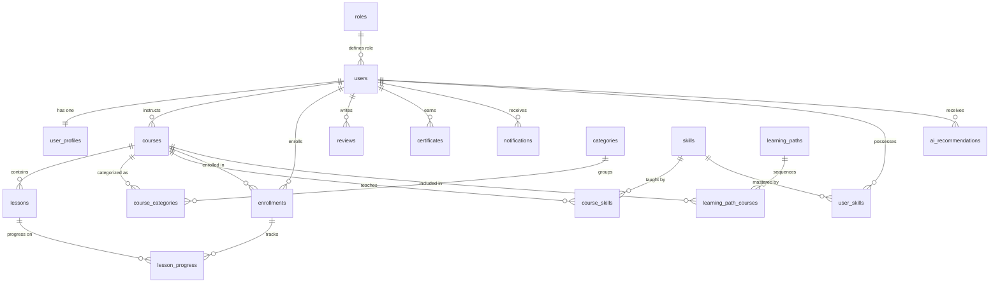

# CodeCraftHub – Database Schema Architecture

## Database: `codecrafthub_db` (PostgreSQL 18)

---

## 1. Entity-Relationship Overview

---

## 2. Table Specifications (18 Normalized Tables)

### 1. `roles`
System access roles for role-based authorization (RBAC).
- `id` (SERIAL PRIMARY KEY)
- `name` (VARCHAR(50) UNIQUE NOT NULL) - `student`, `instructor`, `admin`
- `description` (TEXT)
- `created_at` (TIMESTAMPTZ DEFAULT CURRENT_TIMESTAMP)

### 2. `users`
Authentication credentials and status.
- `id` (UUID PRIMARY KEY DEFAULT gen_random_uuid())
- `email` (VARCHAR(255) UNIQUE NOT NULL)
- `password_hash` (VARCHAR(255) NOT NULL - bcrypt 10 rounds)
- `role_id` (INTEGER NOT NULL REFERENCES roles(id) ON DELETE RESTRICT)
- `is_active` (BOOLEAN DEFAULT true)
- `email_verified` (BOOLEAN DEFAULT false)
- `last_login_at` (TIMESTAMPTZ)
- `created_at` (TIMESTAMPTZ DEFAULT CURRENT_TIMESTAMP)
- `updated_at` (TIMESTAMPTZ DEFAULT CURRENT_TIMESTAMP)

### 3. `user_profiles`
Detailed developer profiles, bios, goals, and social links.
- `id` (UUID PRIMARY KEY DEFAULT gen_random_uuid())
- `user_id` (UUID UNIQUE NOT NULL REFERENCES users(id) ON DELETE CASCADE)
- `first_name` (VARCHAR(100) NOT NULL)
- `last_name` (VARCHAR(100) NOT NULL)
- `headline` (VARCHAR(255))
- `bio` (TEXT)
- `avatar_url` (VARCHAR(512))
- `github_url` (VARCHAR(255))
- `linkedin_url` (VARCHAR(255))
- `website_url` (VARCHAR(255))
- `learning_goals` (TEXT[] DEFAULT '{}')
- `preferred_difficulty` (VARCHAR(50) DEFAULT 'All Levels')
- `notification_email` (BOOLEAN DEFAULT true)
- `notification_in_app` (BOOLEAN DEFAULT true)
- `created_at` / `updated_at` (TIMESTAMPTZ)

### 4. `categories`
Technical domain categorization.
- `id` (UUID PRIMARY KEY DEFAULT gen_random_uuid())
- `name` (VARCHAR(100) UNIQUE NOT NULL)
- `slug` (VARCHAR(100) UNIQUE NOT NULL)
- `icon` (VARCHAR(100))
- `description` (TEXT)
- `display_order` (INTEGER DEFAULT 0)
- `created_at` / `updated_at` (TIMESTAMPTZ)

### 5. `courses`
Curriculum definitions, metadata, ratings, and objectives.
- `id` (UUID PRIMARY KEY DEFAULT gen_random_uuid())
- `title` (VARCHAR(255) NOT NULL)
- `slug` (VARCHAR(255) UNIQUE NOT NULL)
- `description` (TEXT NOT NULL)
- `instructor_id` (UUID NOT NULL REFERENCES users(id) ON DELETE RESTRICT)
- `thumbnail_url` (VARCHAR(512))
- `difficulty_level` (VARCHAR(50) CHECK ('Beginner', 'Intermediate', 'Advanced', 'All Levels'))
- `estimated_hours` (NUMERIC(5, 1) DEFAULT 0)
- `is_published` (BOOLEAN DEFAULT false)
- `published_at` (TIMESTAMPTZ)
- `rating_average` (NUMERIC(3, 2) DEFAULT 0.00)
- `rating_count` (INTEGER DEFAULT 0)
- `enrollment_count` (INTEGER DEFAULT 0)
- `learning_objectives` (TEXT[] DEFAULT '{}')
- `prerequisites` (TEXT[] DEFAULT '{}')
- `created_at` / `updated_at` (TIMESTAMPTZ)

### 6. `course_categories`
Many-to-many relationship mapping courses to technical categories.
- `course_id` (UUID NOT NULL REFERENCES courses(id) ON DELETE CASCADE)
- `category_id` (UUID NOT NULL REFERENCES categories(id) ON DELETE CASCADE)
- PRIMARY KEY (`course_id`, `category_id`)

### 7. `lessons`
Individual curriculum units with duration, markdown guide, and video streaming embed.
- `id` (UUID PRIMARY KEY DEFAULT gen_random_uuid())
- `course_id` (UUID NOT NULL REFERENCES courses(id) ON DELETE CASCADE)
- `title` (VARCHAR(255) NOT NULL)
- `slug` (VARCHAR(255) NOT NULL)
- `description` (TEXT)
- `video_url` (VARCHAR(512))
- `content_markdown` (TEXT)
- `order_index` (INTEGER NOT NULL)
- `duration_minutes` (INTEGER DEFAULT 0)
- `is_free_preview` (BOOLEAN DEFAULT false)
- `resources` (JSONB DEFAULT '[]')
- `created_at` / `updated_at` (TIMESTAMPTZ)
- UNIQUE (`course_id`, `order_index`), UNIQUE (`course_id`, `slug`)

### 8. `enrollments`
Course participation, mathematically synchronized progress, and completion timestamp.
- `id` (UUID PRIMARY KEY DEFAULT gen_random_uuid())
- `user_id` (UUID NOT NULL REFERENCES users(id) ON DELETE CASCADE)
- `course_id` (UUID NOT NULL REFERENCES courses(id) ON DELETE CASCADE)
- `enrolled_at` (TIMESTAMPTZ DEFAULT CURRENT_TIMESTAMP)
- `completed_at` (TIMESTAMPTZ)
- `progress_percentage` (NUMERIC(5, 2) DEFAULT 0.00 CHECK (>= 0 AND <= 100))
- `status` (VARCHAR(50) CHECK ('active', 'completed', 'archived', 'paused'))
- `last_accessed_at` (TIMESTAMPTZ)
- `created_at` / `updated_at` (TIMESTAMPTZ)
- UNIQUE (`user_id`, `course_id`)

### 9. `lesson_progress`
Granular student completion state for individual lessons.
- `id` (UUID PRIMARY KEY DEFAULT gen_random_uuid())
- `enrollment_id` (UUID NOT NULL REFERENCES enrollments(id) ON DELETE CASCADE)
- `lesson_id` (UUID NOT NULL REFERENCES lessons(id) ON DELETE CASCADE)
- `completed` (BOOLEAN DEFAULT false)
- `completed_at` (TIMESTAMPTZ)
- `last_accessed_at` (TIMESTAMPTZ DEFAULT CURRENT_TIMESTAMP)
- `notes` (TEXT)
- UNIQUE (`enrollment_id`, `lesson_id`)

### 10. `learning_paths`
Guided roadmaps comprising multiple ordered courses.
- `id` (UUID PRIMARY KEY DEFAULT gen_random_uuid())
- `title` (VARCHAR(255) NOT NULL)
- `slug` (VARCHAR(255) UNIQUE NOT NULL)
- `description` (TEXT NOT NULL)
- `target_role` (VARCHAR(100) NOT NULL)
- `difficulty_level` (VARCHAR(50))
- `estimated_weeks` (INTEGER DEFAULT 4)
- `thumbnail_url` (VARCHAR(512))
- `is_published` (BOOLEAN DEFAULT true)

### 11. `learning_path_courses`
Sequential ordering of courses inside a learning path.
- `learning_path_id` (UUID REFERENCES learning_paths(id) ON DELETE CASCADE)
- `course_id` (UUID REFERENCES courses(id) ON DELETE CASCADE)
- `sequence_order` (INTEGER NOT NULL)
- PRIMARY KEY (`learning_path_id`, `course_id`)
- UNIQUE (`learning_path_id`, `sequence_order`)

### 12. `skills`
Master catalog of developer technologies and concepts.
- `id` (UUID PRIMARY KEY DEFAULT gen_random_uuid())
- `name` (VARCHAR(100) UNIQUE NOT NULL)
- `slug` (VARCHAR(100) UNIQUE NOT NULL)
- `category` (VARCHAR(100) NOT NULL)
- `description` (TEXT)

### 13. `user_skills`
Student skill inventory and verified mastery levels.
- `user_id` (UUID REFERENCES users(id) ON DELETE CASCADE)
- `skill_id` (UUID REFERENCES skills(id) ON DELETE CASCADE)
- `proficiency_level` (VARCHAR(50) CHECK ('Beginner', 'Intermediate', 'Advanced', 'Expert'))
- `verified_at` (TIMESTAMPTZ)
- PRIMARY KEY (`user_id`, `skill_id`)

### 14. `course_skills`
Skills acquired or advanced by completing a specific course.
- `course_id` (UUID REFERENCES courses(id) ON DELETE CASCADE)
- `skill_id` (UUID REFERENCES skills(id) ON DELETE CASCADE)
- `skill_level_gained` (VARCHAR(50) DEFAULT 'Intermediate')
- PRIMARY KEY (`course_id`, `skill_id`)

### 15. `ai_recommendations`
Context-grounded recommendations produced by the AI engine.
- `id` (UUID PRIMARY KEY DEFAULT gen_random_uuid())
- `user_id` (UUID REFERENCES users(id) ON DELETE CASCADE)
- `recommendation_type` (VARCHAR(50) CHECK ('course', 'learning_path', 'skill_gap', 'next_lesson', 'weekly_goal'))
- `recommended_entity_id` (UUID)
- `reason` (TEXT NOT NULL)
- `confidence_score` (NUMERIC(4, 3) CHECK (>= 0 AND <= 1))
- `metadata_json` (JSONB DEFAULT '{}')
- `is_dismissed` (BOOLEAN DEFAULT false)

### 16. `reviews`
Student ratings and feedback for enrolled courses.
- `id` (UUID PRIMARY KEY DEFAULT gen_random_uuid())
- `user_id` (UUID REFERENCES users(id) ON DELETE CASCADE)
- `course_id` (UUID REFERENCES courses(id) ON DELETE CASCADE)
- `rating` (INTEGER CHECK (>= 1 AND <= 5))
- `review_text` (TEXT)
- UNIQUE (`user_id`, `course_id`)

### 17. `certificates`
Cryptographically auditable completion certificates.
- `id` (UUID PRIMARY KEY DEFAULT gen_random_uuid())
- `user_id` (UUID REFERENCES users(id) ON DELETE CASCADE)
- `course_id` (UUID REFERENCES courses(id) ON DELETE CASCADE)
- `certificate_code` (VARCHAR(100) UNIQUE NOT NULL)
- `issued_at` (TIMESTAMPTZ DEFAULT CURRENT_TIMESTAMP)
- `verification_url` (VARCHAR(512))
- UNIQUE (`user_id`, `course_id`)

### 18. `notifications`
Real-time user alerts and learning reminders.
- `id` (UUID PRIMARY KEY DEFAULT gen_random_uuid())
- `user_id` (UUID REFERENCES users(id) ON DELETE CASCADE)
- `title` (VARCHAR(255) NOT NULL)
- `message` (TEXT NOT NULL)
- `type` (VARCHAR(50) CHECK ('info', 'success', 'warning', 'recommendation', 'achievement'))
- `is_read` (BOOLEAN DEFAULT false)
- `action_url` (VARCHAR(512))

---

## 3. Database Triggers & Data Integrity Guarantees

1. **Automatic Timestamp Synchronization (`update_updated_at_column`)**
   Executes before `UPDATE` on all mutable tables (`users`, `user_profiles`, `courses`, `lessons`, `enrollments`, `lesson_progress`, `reviews`).

2. **Mathematical Enrollment Progress Guarantee (`sync_enrollment_progress`)**
   Whenever a lesson is marked completed or uncompleted in `lesson_progress`:
   - Calculates total course lessons: $N$
   - Calculates completed course lessons: $C$
   - Sets `enrollments.progress_percentage = ROUND((C / N) * 100, 2)`
   - When progress reaches 100%, automatically sets `status = 'completed'` and records `completed_at = CURRENT_TIMESTAMP`.
   - Prevents stale, redundant, or contradictory progress metrics.

